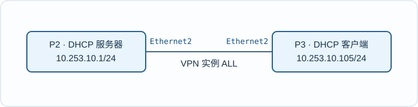

# 在 VPN 实例内分配固定 IPv4 租约

## 拓扑



## 配置条件

在 P2 和 P3 上准备同名 IPv4 VPN 实例 `ALL`。使用两台设备的三层 Ethernet2 直连。P2 提供 `10.253.10.0/24` 的地址，并将 `10.253.10.105` 保留给 P3。通过 `display interface Ethernet2` 核对 P3 实际 MAC，再将配置中的示例 MAC 替换为该值。

## 配置步骤

**P2**

```vortexros-config
enable dhcp server
#
ip vpn-instance ALL
 ipv4-family
  route-distinguisher 65000:2
#
interface Ethernet 2
 ip binding vpn-instance ALL
 ip address 10.253.10.1 255.255.255.0
 dhcp select interface
 dhcp server ip-range 10.253.10.100 10.253.10.110
 dhcp server gateway-list 10.253.10.1
 dhcp server lease day 0 hour 2
 dhcp server excluded-ip-address 10.253.10.106
 dhcp server static-bind ip-address 10.253.10.105 mac-address 0200-0000-0301
#
return
```

**P3**

```vortexros-config
ip vpn-instance ALL
 ipv4-family
  route-distinguisher 65000:3
#
interface Ethernet 2
 ip binding vpn-instance ALL
 ip address dhcp-alloc
 undo dhcp client default-route enable
 undo dhcp client classless-route enable
#
return
```

在 P2 提交并确认服务就绪，再在 P3 提交。这里关闭自动安装路由，便于单独核对地址分配和 VPN 归属。

## 验证与撤销

在 P2 查询地址池和服务，在 P3 查询租约信息。

```vortexros-cli
display ip pool interface Ethernet2
display dhcp service verbose
display dhcp client interface Ethernet2
```

P3 取得固定租约。以下为实测回显节选，端口名按拓扑整理。

```text
Interface  Address-Family  Role    Pool/Servers  VPN-Instance  State    Address           Delegated-Prefix
Ethernet2  IPv4            client  -             ALL           running  10.253.10.105/24  -
```

从 P3 在 `ALL` 内测试 `10.253.10.1`。撤销时先停用 P3 的 `ip address dhcp-alloc`，再移除 P2 的固定绑定和服务器配置。复查 P3 无活动租约。
