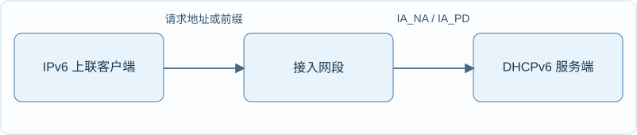

# 获取 IPv6 地址并续租

## 拓扑



## 配置条件

确认上游支持有状态地址分配或前缀委派。如果还需要默认路由，请准备 RA。

有状态地址、前缀委派以及立即续租的示例：

## 配置步骤

```text
interface Ethernet 1
 ipv6 address auto dhcp
 dhcpv6 client pd CPE-PREFIX
commit
display dhcpv6 client interface Ethernet 1
display dhcpv6 client prefix name CPE-PREFIX
# 在接口视图立即请求续租：
interface Ethernet 1
 dhcpv6 client renew
```

`display dhcpv6 client`分别显示IA_NA地址和IA_PD委派前缀，不会用其中一个字段遮盖另一个字段。`dhcpv6 client renew`是立即执行的运行命令，不进入待提交配置或保存配置。

如需在同一接口通过 RA 接受默认路由，可在接口配置 `ipv6 nd ra default-route enable`。用对应的 undo 命令撤销地址获取、前缀委派或 RA 设置。

## 验证方法

对照{ref}`本功能页的实测结果 <recorded-result-08-network-services-dhcpv6-client>`可以核对设备实际显示的字段或业务表现。不同拓扑请按本案例的地址和接口检查。

对照以下命令和预期结果核对设备状态。

```vortexros-cli
display dhcpv6 client interface Ethernet 1
display dhcpv6 client prefix name CPE-PREFIX
```

分别检查 IA_NA 和 IA_PD 的租约状态。续租后确认相应租约和业务仍可用。
