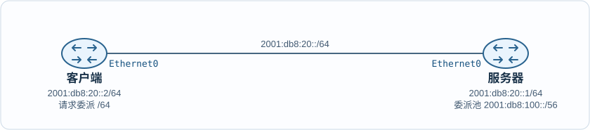

# 联动服务器的前缀委派

## 拓扑



## 配置条件

服务器与客户端的 Ethernet0 直连，传输网段使用 `2001:db8:20::/64`。服务器从 `2001:db8:100::/56` 选取一个 `/64` 委派给客户端。客户端的 Ethernet1 连接下游主机，并使用获配前缀中的地址。两个接口均使用三层模式。此案例验证委派和下游首跳，默认路由与更远网段的回程需另行配置。

## 配置步骤

**服务器 R1**

```vortexros-config
enable dhcp server
#
dhcpv6 pool PD
 prefix-delegation 2001:db8:100::/56 64 life-time 3600 1800
#
interface Ethernet 0
 ipv6 enable
 ipv6 address 2001:db8:20::1 64
 dhcpv6 server PD
#
return
```

在 R1 的系统视图录入并提交上述配置。

**客户端 R2**

```vortexros-config
interface Ethernet 0
 ipv6 enable
 ipv6 address 2001:db8:20::2 64
 dhcpv6 client pd CPE-PREFIX
#
interface Ethernet 1
 ipv6 enable
 ipv6 address dhcpv6-prefix CPE-PREFIX ::1/64
#
return
```

提交后，Ethernet1 使用委派前缀与后缀 `::1` 组合出的地址。例如获配 `2001:db8:100:1::/64` 时，Ethernet1 的地址为 `2001:db8:100:1::1/64`。下游主机可以临时设置为 `2001:db8:100:1::2/64`，随后从主机探测 R2 的 Ethernet1。按设备实际获得的前缀替换示例地址。

## 验证方法

对照{ref}`本功能页的实测结果 <recorded-result-08-network-services-dhcpv6-client>`可以核对设备实际显示的字段或业务表现。不同拓扑请按本案例的地址和接口检查。

在 R1 查看租约，在 R2 核对前缀和下游接口地址。

```vortexros-cli
display dhcpv6 pool name PD used
```

```vortexros-cli
display dhcpv6 client prefix name CPE-PREFIX
display ipv6 interface brief
```

预期 R1 的 IA_PD 租约与 R2 显示的前缀一致，长度为 `/64`。R2 的 Ethernet1 应显示从这个前缀派生的地址，下游主机的探测应收到回应。

撤销时，在 R2 的 Ethernet1 下执行 `undo ipv6 address dhcpv6-prefix CPE-PREFIX`，在 Ethernet0 下执行 `undo dhcpv6 client pd` 并提交。复查 R2 的命名前缀和派生地址均已消失。
