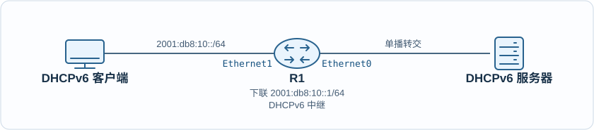

# 指定 DHCPv6 中继地址

## 拓扑



## 配置条件

在客户端所在的三层接口配置中继，确认目标服务器可达并为接入链路准备 IPv6 地址池。

## 配置步骤

```vortexros-config
interface Ethernet 1
 ipv6 enable
 ipv6 address 2001:db8:10::1 64
 dhcpv6 relay destination 2001:db8:20::10
#
return
```

录入后提交。在 DPDK 模式也可使用承载客户网段的 Vlanif。需取消时执行 `undo dhcpv6 relay destination 2001:db8:20::10` 后提交。

## 验证方法

对照{ref}`本功能页的实测结果 <recorded-result-08-network-services-dhcpv6-relay>`可以核对设备实际显示的字段或业务表现。不同拓扑请按本案例的地址和接口检查。

对照以下命令和预期结果核对设备状态。

```vortexros-cli
display dhcpv6 relay
display ipv6 routing-table
```

核对中继接口和目的地址的路径。客户端触发请求后，从服务端核对已分配租约。
