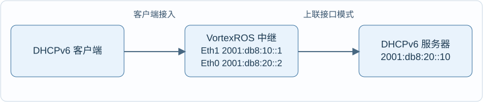

# 上联接口模式与三节点租约

## 拓扑



## 配置条件

在客户端所在的三层接口配置中继，确认目标服务器可达并为接入链路准备 IPv6 地址池。

服务器 Ethernet0 连中继 Ethernet0，使用 2001:db8:20::/64。中继 Ethernet1 连客户端，使用 2001:db8:10::/64。本案例使用上联接口模式。另见[指定 DHCPv6 中继地址](example-1.md)。

## 配置步骤

**服务器**

```vortexros-config
enable dhcp server
#
dhcpv6 pool ACCESS6
 address prefix 2001:db8:10::/64 life-time 3600 1800
 excluded-address 2001:db8:10::1
#
interface Ethernet 0
 ipv6 enable
 ipv6 address 2001:db8:20::10 64
 dhcpv6 server ACCESS6
#
ipv6 route-static 2001:db8:10:: 64 2001:db8:20::2
#
return
```

**中继**

```vortexros-config
interface Ethernet 0
 ipv6 enable
 ipv6 address 2001:db8:20::2 64
#
interface Ethernet 1
 ipv6 enable
 ipv6 address 2001:db8:10::1 64
 dhcpv6 relay interface Ethernet0
#
return
```

**客户端**

```vortexros-config
interface Ethernet 0
 ipv6 enable
 ipv6 address auto dhcp
#
ipv6 route-static 2001:db8:10:: 64 Ethernet0
#
return
```

分别提交。中继执行 `display dhcpv6 relay`，服务器执行 `display dhcpv6 pool name ACCESS6 used`，客户端执行 `display dhcpv6 client interface Ethernet0`。正常时中继在下联运行并指向 Ethernet0，服务器显示 IA_NA 租约，客户端取得 2001:db8:10::/64 内的地址并能 ping 中继的 ::1。其他网段的默认路由另配。

## 验证方法

对照{ref}`本功能页的实测结果 <recorded-result-08-network-services-dhcpv6-relay>`可以核对设备实际显示的字段或业务表现。不同拓扑请按本案例的地址和接口检查。

对照以下命令和预期结果核对设备状态。

```vortexros-cli
display dhcpv6 relay
display dhcpv6 pool name ACCESS6 used
display dhcpv6 client interface Ethernet0
```

分别查询中继、服务端和客户端。正常时在各自设备看到运行中继、IA_NA 和分配的同一地址。
