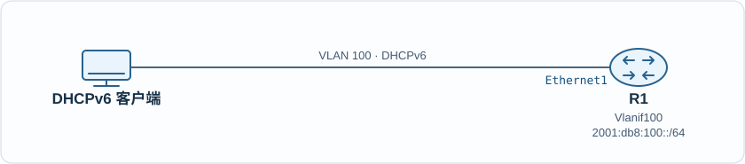

# DHCPv6 服务器 配置案例

## 拓扑



(case-conditions-08-network-services-dhcpv6-server)=
## 配置条件

准备三层接口、地址池和 IPv6 前缀。地址与委派前缀应使用统一的有效和首选生命周期。

## 配置步骤

```text
dhcpv6 pool LAN6
 address prefix 2001:db8:100::/64
 dns-server 2001:4860:4860::8888
#
interface Vlanif 100
 dhcpv6 server LAN6
```

验证和撤销：

```text
display dhcp service verbose
display ipv6 pool
interface Vlanif 100
 undo dhcpv6 server
commit
```

录入接口和地址池后提交，再测试租约。

```vortexros-cli
display dhcpv6 pool name LAN6 used
display ipv6 pool name LAN6 all
```

(case-verification-08-network-services-dhcpv6-server)=
## 验证方法

对照以下命令和预期结果核对设备状态。

```vortexros-cli
display dhcp service verbose
display ipv6 pool
display dhcpv6 pool name LAN6 used
```

让客户端发起租约请求。确认地址或委派前缀、DUID、IAID 与剩余租期。
