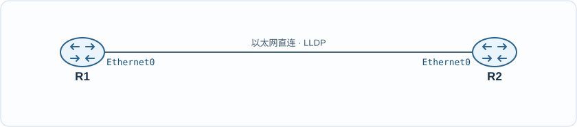

# 启用与关闭 LLDP

## 拓扑



## 配置条件

在需观察的链路两端启用 LLDP，并确认物理链路已连接。

## 配置步骤

```text
enable lldp
commit
display lldp neighbor brief
display lldp neighbor interface Ethernet0
```

关闭LLDP：

```text
undo lldp enable
commit
```

## 验证方法

对照{ref}`本功能页的实测结果 <recorded-result-08-network-services-lldp>`可以核对设备实际显示的字段或业务表现。不同拓扑请按本案例的地址和接口检查。

对照以下命令和预期结果核对设备状态。

```vortexros-cli
display lldp neighbor brief
display lldp neighbor interface Ethernet0
```

两端启用后核对远端名称和端口；关闭后等待旧记录到期并重新查询。
