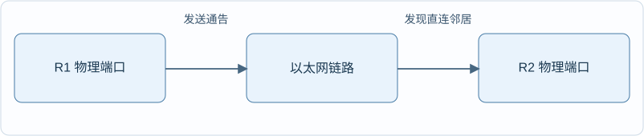

# 两端对照管理口接线

## 拓扑



## 配置条件

在需观察的链路两端启用 LLDP，并确认物理链路已连接。

用一根网线把 R1 的 Ethernet0 接到 R2 的 Ethernet2。两端在系统视图都执行以下配置并提交。

## 配置步骤

```text
enable lldp
commit
```

## 验证方法

对照{ref}`本功能页的实测结果 <recorded-result-08-network-services-lldp>`可以核对设备实际显示的字段或业务表现。不同拓扑请按本案例的地址和接口检查。

对照以下命令和预期结果核对设备状态。

```vortexros-cli
display lldp local
display lldp neighbor brief
display lldp neighbor interface Ethernet0
```

R1 应看到远端的设备名及 Ethernet2，R2 应在 Ethernet2 看到 R1 的 Ethernet0。更换接线后，等待旧条目过期并检查新条目。
