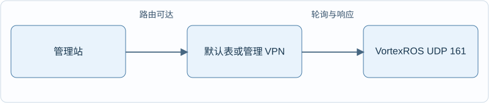

# 用 SNMPv2c 核对监听

## 拓扑



## 配置条件

准备管理站和设备管理接口。下例使用 v2c 联调，请将 COMMUNITY 替换为设备专用的团体名。

## 配置步骤

```vortexros-config
interface Ethernet 0
 ip address 192.0.2.2 255.255.255.0
#
snmp-agent
snmp-agent sys-info version v2c
snmp-agent community read COMMUNITY
snmp-agent protocol source-interface Ethernet0
#
return
```

在系统视图录入并提交。

只读轮询支持 SNMPv2c，SNMPv3 使用 `authPriv`、SHA2-256 和 AES128。使用 `snmp-agent protocol source-interface vpn-instance NAME IFNAME` 时，先确认接口与管理实例一致且具有 IPv4 地址。授权凭据应使用设备专用值。

## 验证方法

对照{ref}`本功能页的实测结果 <recorded-result-08-network-services-snmp>`可以核对设备实际显示的字段或业务表现。不同拓扑请按本案例的地址和接口检查。

对照以下命令和预期结果核对设备状态。

```vortexros-cli
display snmp-agent sys-info
display process udp listen
```

来自管理站的轮询应经实际配置的接口和路由表验证。设备查询监听使用 UDP 161，通知发送到配置的 IPv4 目标。用 `undo snmp-agent` 删除整套 SNMP 配置，并在提交后检查监听已撤销。
