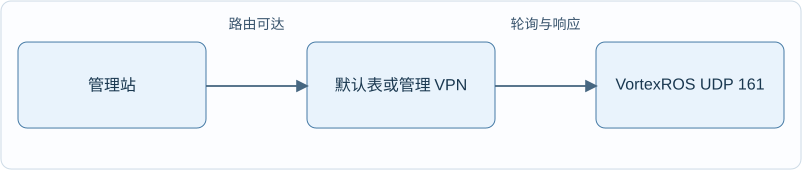

# 管理 VPN 内的 SNMPv3 轮询

## 拓扑



## 配置条件

准备管理站和设备管理接口。下例使用 v2c 联调，请将 COMMUNITY 替换为设备专用的团体名。

设备 Ethernet0 属于 MGMT，地址 192.0.2.2/24。管理站 192.0.2.10/24 经相同网段访问。准备独立的认证和加密口令，在双方配置一致的算法。以下口令仅为占位，请在操作时替换。

## 配置步骤

```text
system-view
snmp-agent
snmp-agent sys-info version v3
snmp-agent usm-user v3 monitor authentication-mode sha2-256 AUTH-PASSPHRASE privacy-mode aes128 PRIV-PASSPHRASE
snmp-agent protocol source-interface vpn-instance MGMT Ethernet0
commit
return
```

## 验证方法

对照{ref}`本功能页的实测结果 <recorded-result-08-network-services-snmp>`可以核对设备实际显示的字段或业务表现。不同拓扑请按本案例的地址和接口检查。

对照以下命令和预期结果核对设备状态。

```vortexros-cli
display snmp-agent sys-info
display snmp-agent usm-user
display process udp listen
```

应看到 v3、用户 monitor 以及 UDP 161。管理站用 authPriv、SHA2-256 和 AES128 查询设备系统信息并检查收到响应。若绑定在 MGMT，使用其他实例的测试管理站时应按相应路由和准入配置验证。
