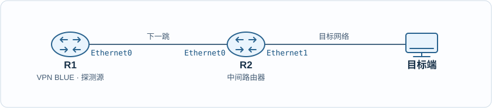

(section-operator-09-operations-connectivity-1)=
# Ping、Tracert 与 MTR 连通性诊断

<span id="overview"></span>

Ping 检查端到端可达性，Tracert 查看逐跳路径，MTR 持续观察丢包与延迟。可从指定 VPN 进行诊断。

<span id="principles"></span>

(section-operator-09-operations-connectivity-2)=
## 工作原理

支持 Ping、Tracert、MTR，并可选择 VPN 发出探测。

<span id="examples"></span>

(section-operator-09-operations-connectivity-3)=
## 配置与验证

(section-operator-09-operations-connectivity-4)=
### 拓扑



(case-conditions-09-operations-connectivity)=
### 配置条件

准备目标地址，先确认应该使用默认路由表还是业务 VPN。

(section-operator-09-operations-connectivity-5)=
### 配置步骤

```vortexros-cli
ping 192.0.2.1
ping -vpn-instance BLUE 10.0.0.1
tracert 198.51.100.1
mtr -vpn-instance BLUE 10.0.0.1
```

按 Ctrl+C 结束当前诊断命令，保留登录会话。

(case-verification-09-operations-connectivity)=
### 验证方法

对照以下命令和预期结果核对设备状态。

```vortexros-cli
display ip routing-table vpn-instance BLUE
display ip interface brief
```

确认目标已匹配所需路由及出接口。比较实际 Ping 和路径结果；防火墙阻止 ICMP 时，再验证业务所用的协议。

<span id="observed"></span>

(closeout-result-operator-09-operations-connectivity)=
### 先核对设备状态再做连通性诊断

三节点验证在阻断一条聚合成员链路后仍从另一端收到 ICMP 回应。检查聚合状态和独立的去程回程可达性后再定位经过的链路。同一拓扑的实际 LACP 回显见 [Eth-Trunk](../03-interfaces-l2/eth-trunk.md)。

<span id="precautions"></span>

(section-operator-09-operations-connectivity-6)=
## 注意事项

ICMP 结果受路径中设备的限速与准入影响。用业务协议复核，避免只凭中间跳的丢包判断端到端失败。

<p data-legacy-id="id1" class="manual-previous-section" data-section-moved><a href="#overview">介绍</a></p>
<p data-legacy-id="id2" class="manual-previous-section" data-section-moved><a href="#case-conditions-09-operations-connectivity">配置准备</a></p>
<p data-legacy-id="id3" class="manual-previous-section" data-section-moved><a href="#examples">配置案例</a></p>
<p data-legacy-id="id4" class="manual-previous-section" data-section-moved><a href="#case-verification-09-operations-connectivity">验证配置</a></p>
