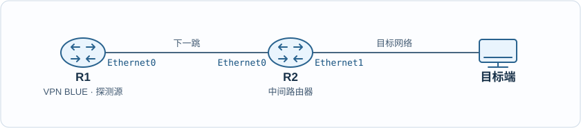

# Ping、Tracert 与 MTR 连通性诊断 配置案例

## 拓扑



(case-conditions-09-operations-connectivity)=
## 配置条件

准备目标地址，先确认应该使用默认路由表还是业务 VPN。

## 配置步骤

```vortexros-cli
ping 192.0.2.1
ping -vpn-instance BLUE 10.0.0.1
tracert 198.51.100.1
mtr -vpn-instance BLUE 10.0.0.1
```

按 Ctrl+C 结束当前诊断命令，保留登录会话。

(case-verification-09-operations-connectivity)=
## 验证方法

对照以下命令和预期结果核对设备状态。

```vortexros-cli
display ip routing-table vpn-instance BLUE
display ip interface brief
```

确认目标已匹配所需路由及出接口。比较实际 Ping 和路径结果；防火墙阻止 ICMP 时，再验证业务所用的协议。
