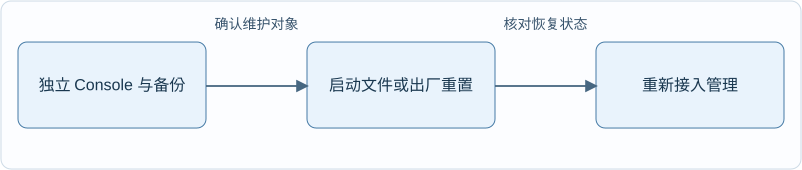

(section-operator-09-operations-factory-reset-1)=
# 配置恢复与出厂重置

<span id="overview"></span>

可单独重置启动配置文件，或恢复整机出厂配置。出厂操作会清理受管账户与服务状态。

<span id="principles"></span>

(section-operator-09-operations-factory-reset-2)=
## 工作原理

可单独重置启动文件，或恢复整机出厂配置。运行和启动配置的影响范围不同。

<span id="examples"></span>

(section-operator-09-operations-factory-reset-3)=
## 配置与验证

(section-operator-09-operations-factory-reset-4)=
### 操作流程



(case-conditions-09-operations-factory-reset)=
### 配置条件

准备独立 Console，并备份当前可用配置。启动配置重置不会立即撤销当前运行中的业务；整机重置需要业务窗口。

(section-operator-09-operations-factory-reset-5)=
### 配置步骤

以下为将当前启动文件重置为出厂配置的用户视图示例，执行前先选择要操作的设备。

```vortexros-cli
display startup
reset saved-configuration
display startup
```

若要同时恢复运行和启动状态，请按 Console 提示执行 `restore factory-configuration`。恢复后完成首次改密，再重新建立管理通道。

(case-verification-09-operations-factory-reset)=
### 验证方法

对照以下命令和预期结果核对设备状态。

```vortexros-cli
display startup
display current-configuration
display users
```

核对启动文件。以空配置或出厂配置重启后再次查询，确认只保留预期的默认设置。

<span id="observed"></span>

(result-operator-09-operations-factory-reset)=
### 出厂和空 CFG 启动的实测结果

r5 从已确认镜像执行出厂恢复，重启后用默认管理员登录并按提示完成首次改密。验证旧的受管账号和公钥已撤销，Linux 系统账号仍可供系统服务使用。另用空 CFG 冷启动复查相同的首次改密流程。

<span id="precautions"></span>

(section-operator-09-operations-factory-reset-6)=
## 注意事项

整机重置前先从独立 Console 确认、备份和验证可恢复路径。操作完成后按提示更改初始口令。

<p data-legacy-id="id2" class="manual-previous-section" data-section-moved><a href="#overview">介绍</a></p>
<p data-legacy-id="id3" class="manual-previous-section" data-section-moved><a href="#case-conditions-09-operations-factory-reset">配置准备</a></p>
<p data-legacy-id="id4" class="manual-previous-section" data-section-moved><a href="#examples">配置案例</a></p>
<p data-legacy-id="id5" class="manual-previous-section" data-section-moved><a href="#case-verification-09-operations-factory-reset">验证配置</a></p>
