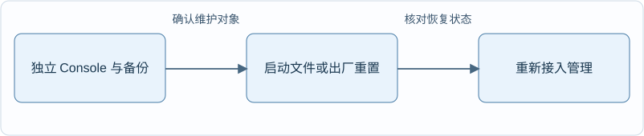

# 配置恢复与出厂重置 配置案例

## 操作流程



(case-conditions-09-operations-factory-reset)=
## 配置条件

准备独立 Console，并备份当前可用配置。启动配置重置不会立即撤销当前运行中的业务；整机重置需要业务窗口。

## 配置步骤

以下为将当前启动文件重置为出厂配置的用户视图示例，执行前先选择要操作的设备。

```vortexros-cli
display startup
reset saved-configuration
display startup
```

若要同时恢复运行和启动状态，请按 Console 提示执行 `restore factory-configuration`。恢复后完成首次改密，再重新建立管理通道。

(case-verification-09-operations-factory-reset)=
## 验证方法

对照以下命令和预期结果核对设备状态。

```vortexros-cli
display startup
display current-configuration
display users
```

核对启动文件。以空配置或出厂配置重启后再次查询，确认只保留预期的默认设置。
