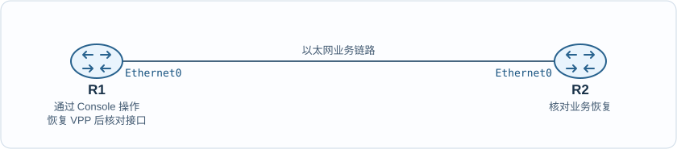

# 恢复 VPP 与核对接口状态

## 操作流程



## 配置条件

选择影响范围最小的操作。清空动态表项或重启服务前确认业务窗口和可用的 Console。

在独立 Console 上操作。记录当前接口归属、管理接入和可达的业务目的。确认计划重启数据面的影响范围后执行。

## 配置步骤

```vortexros-cli
display vpp api compatibility verbose
display vpp interface-ownership verbose
display vpp takeover transaction
display service verbose
reset service vpp
```

恢复后重新查看 VPP 服务、接口和最近一次接管状态。正常时原有 DPDK 接口应恢复归属，接口地址和转发表应恢复。最后从隔离对端验证双向转发。需要重新学习 MAC 时，可在维护窗口用 `reset mac-address` 清理动态表项，随后用 `display mac-address` 核对重新学习。

## 验证方法

对照以下命令和预期结果核对设备状态。

```vortexros-cli
display service verbose
display vpp interface-ownership verbose
display vpp takeover transaction
```

重启后核对服务已恢复、DPDK 接口归属正确及接管已完成，再实际测试双向转发。
