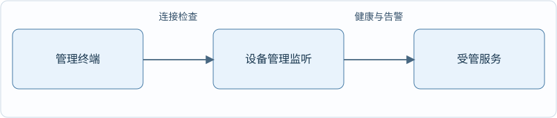

# 服务状态与监听端口 配置案例

## 拓扑



(case-conditions-09-operations-service-health)=
## 配置条件

确定希望排查的服务和协议。远程排查前保留当前会话。

## 配置步骤

以 SSH 不通为例，先确认管理接口与路由，再核对 TCP 监听和 SSH 登录记录。服务状态异常时同时查看告警。

```vortexros-cli
display ip interface brief
display process tcp listen
display ssh user login-info failed
```

(case-verification-09-operations-service-health)=
## 验证方法

对照以下命令和预期结果核对设备状态。

```vortexros-cli
display service verbose
display health
display process listen
display process udp listen
display alarm active
```

核对协议、监听地址、端口和主进程。恢复后从远端新建连接，确认业务可用。
