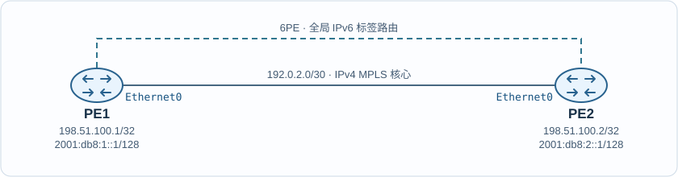

(section-operator-10-mpls-l3vpn-6pe-1)=
# 6PE IPv6 标签路由

<span id="overview"></span>

6PE 让两台 PE 经 IPv4 MPLS 核心交换带标签的全局 IPv6 路由。

<span id="principles"></span>

(section-operator-10-mpls-l3vpn-6pe-2)=
## 工作原理

6PE 在 IPv4 MPLS 核心上传输 IPv6 前缀，核心 P 路由器按外层标签转发。边缘 PE 负责 IPv6 路由选路和业务标签。验证时分别核对边缘路由和核心实包。

通过 IPv4 MPLS 核心交换全局 IPv6 标签路由。两端 PE 使用 IPv4 对等体并启用标签路由能力。

<span id="examples"></span>

(section-operator-10-mpls-l3vpn-6pe-3)=
## 配置与验证

(section-operator-10-mpls-l3vpn-6pe-4)=
### 拓扑



(case-conditions-10-mpls-l3vpn-6pe)=
### 配置条件

两端沿用 [LDP 核心](ldp.md) 的 IPv4 路径与 PE 环回。为 PE1 和 PE2 分别准备 IPv6 环回 2001:db8:1::1/128 和 2001:db8:2::1/128。

(section-operator-10-mpls-l3vpn-6pe-5)=
### 配置步骤

两端分别录入并提交。

**PE1**

```vortexros-config
interface LoopBack 0
 ip address 198.51.100.1 255.255.255.255
#
interface LoopBack 1
 ipv6 enable
 ipv6 address 2001:db8:1::1 128
#
bgp 65000
 router-id 198.51.100.1
 peer 198.51.100.2 as-number 65000
 peer 198.51.100.2 connect-interface LoopBack0
 ipv6-family unicast
  peer 198.51.100.2 enable
  peer 198.51.100.2 label-route-capability
  network 2001:db8:1::1 128
#
return
```

**PE2**

```vortexros-config
interface LoopBack 0
 ip address 198.51.100.2 255.255.255.255
#
interface LoopBack 1
 ipv6 enable
 ipv6 address 2001:db8:2::1 128
#
bgp 65000
 router-id 198.51.100.2
 peer 198.51.100.1 as-number 65000
 peer 198.51.100.1 connect-interface LoopBack0
 ipv6-family unicast
  peer 198.51.100.1 enable
  peer 198.51.100.1 label-route-capability
  network 2001:db8:2::1 128
#
return
```

(case-verification-10-mpls-l3vpn-6pe)=
### 验证方法

对照以下命令和预期结果核对设备状态。

```vortexros-cli
display bgp ipv6 routing-table
display ipv6 routing-table
display mpls forwarding-table
```

PE1 应在全局 IPv6 表中看到 2001:db8:2::1/128，BGP 下一跳对应 PE2 IPv4 环回的映射地址，核心可查到标签转发。PE2 应看到反向路由。分别使用本地 IPv6 环回为源 ping 对端。撤销一端的 `label-route-capability` 后，核对标签业务路由撤销。

<span id="observed"></span>

(section-operator-10-mpls-l3vpn-6pe-6)=
### IPv4 MPLS 承载 IPv6 的实测结果

在四节点 IPv4 MPLS 网络上通过 6PE 建立公网 IPv6 可达性。实包验证了 IPv6 转发及环网故障恢复。检查入口 PE 的 IPv6 路由及 MPLS 标签时，应同时核对输送路径和目标 IPv6 前缀。

(query-result-10-mpls-l3vpn-6pe)=
### 命令回显实测节选

在 6PE 验证中，P1 收到远端路由 2001:db8:104::1/128，下一跳显示为 ::ffff:4.4.4.4。同测试的公网 IPv6 探测收到 3/3 回应。

```text
<P1> display bgp ipv6 routing-table
Total Number of Routes: 2
     Network             NextHop                MED     LocPrf Path/Ogn
 *>  2001:db8:101::1/128 ::                       0            i
 *>  2001:db8:104::1/128 ::ffff:4.4.4.4           0        100 i
```

<span id="precautions"></span>

(section-operator-10-mpls-l3vpn-6pe-7)=
## 注意事项

先验证 IGP、LDP 和 PE 环回可达。确认带标签 IPv6 路径再测试实际双向流量。

<p data-legacy-id="id1" class="manual-previous-section" data-section-moved><a href="#overview">介绍</a></p>
<p data-legacy-id="id2" class="manual-previous-section" data-section-moved><a href="#case-conditions-10-mpls-l3vpn-6pe">配置准备</a></p>
<p data-legacy-id="id3" class="manual-previous-section" data-section-moved><a href="#examples">配置案例</a></p>
<p data-legacy-id="id4" class="manual-previous-section" data-section-moved><a href="#case-verification-10-mpls-l3vpn-6pe">验证配置</a></p>
