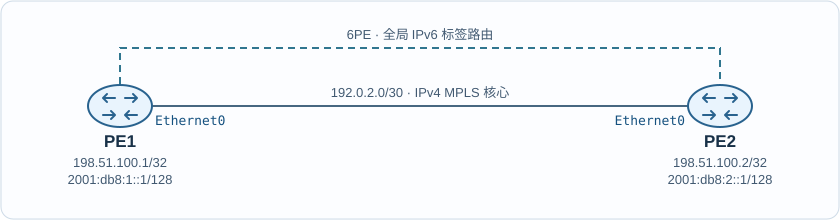

# 6PE IPv6 标签路由 配置案例

## 拓扑



(case-conditions-10-mpls-l3vpn-6pe)=
## 配置条件

两端沿用 [LDP 核心](../ldp.md) 的 IPv4 路径与 PE 环回。为 PE1 和 PE2 分别准备 IPv6 环回 2001:db8:1::1/128 和 2001:db8:2::1/128。

## 配置步骤

两端分别录入并提交。

**PE1**

```vortexros-config
interface LoopBack 0
 ip address 198.51.100.1 255.255.255.255
#
interface LoopBack 1
 ipv6 enable
 ipv6 address 2001:db8:1::1 128
#
bgp 65000
 router-id 198.51.100.1
 peer 198.51.100.2 as-number 65000
 peer 198.51.100.2 connect-interface LoopBack0
 ipv6-family unicast
  peer 198.51.100.2 enable
  peer 198.51.100.2 label-route-capability
  network 2001:db8:1::1 128
#
return
```

**PE2**

```vortexros-config
interface LoopBack 0
 ip address 198.51.100.2 255.255.255.255
#
interface LoopBack 1
 ipv6 enable
 ipv6 address 2001:db8:2::1 128
#
bgp 65000
 router-id 198.51.100.2
 peer 198.51.100.1 as-number 65000
 peer 198.51.100.1 connect-interface LoopBack0
 ipv6-family unicast
  peer 198.51.100.1 enable
  peer 198.51.100.1 label-route-capability
  network 2001:db8:2::1 128
#
return
```

(case-verification-10-mpls-l3vpn-6pe)=
## 验证方法

对照以下命令和预期结果核对设备状态。

```vortexros-cli
display bgp ipv6 routing-table
display ipv6 routing-table
display mpls forwarding-table
```

PE1 应在全局 IPv6 表中看到 2001:db8:2::1/128，BGP 下一跳对应 PE2 IPv4 环回的映射地址，核心可查到标签转发。PE2 应看到反向路由。分别使用本地 IPv6 环回为源 ping 对端。撤销一端的 `label-route-capability` 后，核对标签业务路由撤销。
