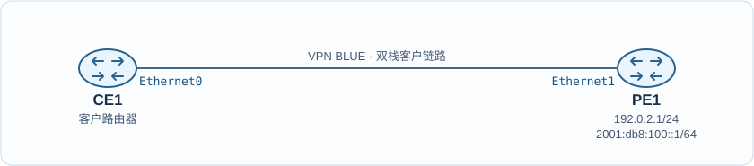

# 配置双栈客户侧 VPN 接口

## 拓扑



## 配置条件

预先建立 PE 之间的 MPLS/LDP 与 MP-BGP 会话，准备客户接口、独立 RD 及两端匹配的 RT。

## 配置步骤

```vortexros-config
ip vpn-instance BLUE
 ipv4-family
  route-distinguisher 65000:100
  vpn-target 65000:100 both
 ipv6-family
  route-distinguisher 65000:100
  vpn-target 65000:100 both
#
interface Ethernet 1
 ip binding vpn-instance BLUE
 ip address 192.0.2.1 255.255.255.0
 ipv6 address 2001:db8:100::1 64
#
return
```

在各 PE 绑定客户接口后提交。配置 PE–CE 路由和 MP-BGP 地址族，两端 RD 按各自规划设置。撤销时先停止发布并确认远端路由撤销，再解除客户接口绑定。

## 验证方法

对照{ref}`本功能页的实测结果 <recorded-result-10-mpls-l3vpn-l3vpn>`可以核对设备实际显示的字段或业务表现。不同拓扑请按本案例的地址和接口检查。

对照以下命令和预期结果核对设备状态。

```vortexros-cli
display ip routing-table vpn-instance BLUE
display ipv6 routing-table vpn-instance BLUE
display mpls forwarding-table
```

核对客户前缀处于 BLUE 中，远端前缀关联正确的标签路径，分别从两站点验证双栈业务。
