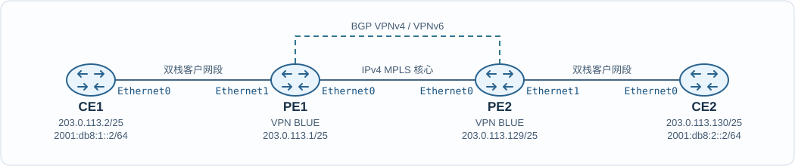

# IPv4 核心同时承载 VPNv4 和 VPNv6

## 拓扑



## 配置条件

预先建立 PE 之间的 MPLS/LDP 与 MP-BGP 会话，准备客户接口、独立 RD 及两端匹配的 RT。

CE1 — PE1 Ethernet1 — IPv4 MPLS 核心 — PE2 Ethernet1 — CE2。复用 [两端 LDP](../../ldp.md) 的 Ethernet0 与两台 PE 的 IPv4 环回，核心口保留 ipv6 enable，仅用 IPv4 IGP 和 LDP。CE1 用 203.0.113.2/25 与 2001:db8:1::2/64。CE2 用 203.0.113.130/25 与 2001:db8:2::2/64。默认网关为各自 PE 的客户侧 IPv4 和 IPv6 地址。

## 配置步骤

**本端设备**

```vortexros-config
interface LoopBack 0
 ip address 198.51.100.1 255.255.255.255
#
ip vpn-instance BLUE
 ipv4-family
  route-distinguisher 65000:101
  vpn-target 65000:100 both
 #
 ipv6-family
  route-distinguisher 65000:201
  vpn-target 65000:100 both
#
interface Ethernet 1
 ip binding vpn-instance BLUE
 ip address 203.0.113.1 255.255.255.128
 ipv6 enable
 ipv6 address 2001:db8:1::1 64
#
bgp 65000
 router-id 198.51.100.1
 peer 198.51.100.2 as-number 65000
 peer 198.51.100.2 connect-interface LoopBack0
 ipv4-family vpnv4
  peer 198.51.100.2 enable
 #
 ipv6-family vpnv6
  peer 198.51.100.2 enable
 #
 ipv4-family vpn-instance BLUE
  import-route direct
 #
 ipv6-family vpn-instance BLUE
  import-route direct
#
return
```

**对端设备**

```vortexros-config
interface LoopBack 0
 ip address 198.51.100.2 255.255.255.255
#
ip vpn-instance BLUE
 ipv4-family
  route-distinguisher 65000:102
  vpn-target 65000:100 both
 #
 ipv6-family
  route-distinguisher 65000:202
  vpn-target 65000:100 both
#
interface Ethernet 1
 ip binding vpn-instance BLUE
 ip address 203.0.113.129 255.255.255.128
 ipv6 enable
 ipv6 address 2001:db8:2::1 64
#
bgp 65000
 router-id 198.51.100.2
 peer 198.51.100.1 as-number 65000
 peer 198.51.100.1 connect-interface LoopBack0
 ipv4-family vpnv4
  peer 198.51.100.1 enable
 #
 ipv6-family vpnv6
  peer 198.51.100.1 enable
 #
 ipv4-family vpn-instance BLUE
  import-route direct
 #
 ipv6-family vpn-instance BLUE
  import-route direct
#
return
```

## 验证方法

对照{ref}`本功能页的实测结果 <recorded-result-10-mpls-l3vpn-l3vpn>`可以核对设备实际显示的字段或业务表现。不同拓扑请按本案例的地址和接口检查。

对照以下命令和预期结果核对设备状态。

```vortexros-cli
display bgp vpnv4 all
display bgp vpnv6 all
display ip routing-table vpn-instance BLUE
display ipv6 routing-table vpn-instance BLUE
display mpls forwarding-table
```

PE1 应在 BLUE 看到 PE2 的 203.0.113.128/25 和 2001:db8:2::/64，VPNv6 下一跳为 IPv4 映射地址。PE2 应看到反向前缀。CE 两端互 ping，默认路由表中不应学习这些 VPN 前缀。
