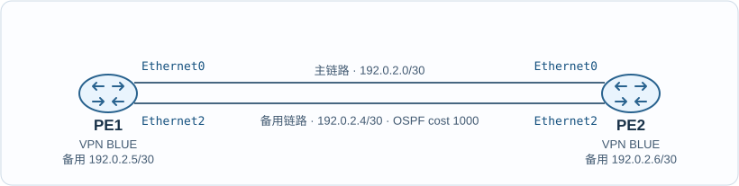

# 增加备用核心链路并验证切换

## 拓扑



## 配置条件

预先建立 PE 之间的 MPLS/LDP 与 MP-BGP 会话，准备客户接口、独立 RD 及两端匹配的 RT。

在已有 VPNv4/VPNv6 的两端 LDP 案例上，将两台 PE 的 Ethernet2 额外互联。主链路仍使用 Ethernet0，备用用 192.0.2.4/30，OSPF 成本设为 1000。两台设备分别录入增量后提交。独立四节点核心同理，可用现有 IGP 及 LDP 协议逐段确认。

## 配置步骤

**PE1**

```vortexros-config
mpls lsr-id 198.51.100.1
mpls
#
mpls ldp
#
interface Ethernet 2
 ip address 192.0.2.5 255.255.255.252
 ipv6 enable
 mpls
 mpls ldp
 ospf network-type p2p
 ospf cost 1000
#
ospf 1
 area 0.0.0.0
  network 192.0.2.5 0.0.0.0
#
return
```

**PE2**

```vortexros-config
mpls lsr-id 198.51.100.2
mpls
#
mpls ldp
#
interface Ethernet 2
 ip address 192.0.2.6 255.255.255.252
 ipv6 enable
 mpls
 mpls ldp
 ospf network-type p2p
 ospf cost 1000
#
ospf 1
 area 0.0.0.0
  network 192.0.2.6 0.0.0.0
#
return
```

## 验证方法

对照以下命令和预期结果核对设备状态。

```vortexros-cli
display ospf 1 interface
display mpls ldp interface
display mpls forwarding-table
display ip routing-table protocol ospf
```

两端先检查备用口启用 MPLS/LDP，远端 PE 环回仍优选主链路。断开 Ethernet0，远端环回与标签转发路径应改经 Ethernet2，CE 间双栈通信应在收敛后恢复。重新接回 Ethernet0，确认主路径恢复。完成后可移除备用接口在 OSPF 的 network 项及接口上的 LDP、MPLS 和测试地址。

[VPN 实例](../../../04-ip-routing/vpn-instance.md) · [BGP 与 MP-BGP](../../../05-dynamic-routing/bgp.md)
