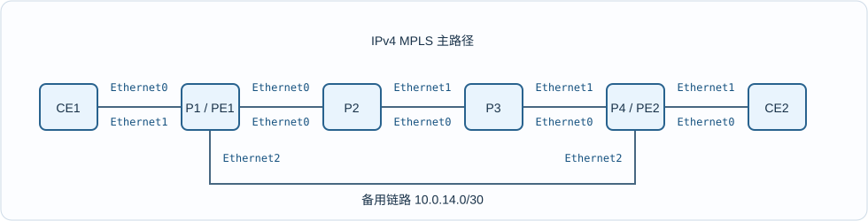

# IPv4 骨干上的 6PE、6VPE 与链路切换

同一组 IPv4 MPLS 骨干同时传送公网 6PE 流量和租户 6VPE 流量。正常情况下，两端 PE 经 P2 和 P3 转发。断开 P2 与 P3 之间的链路后，两端改用 PE 之间的高成本链路。

## 拓扑



| 链路或地址 | 一端 | 另一端 |
| --- | --- | --- |
| P1–P2 | P1 Ethernet0，`10.0.12.1/30` | P2 Ethernet0，`10.0.12.2/30` |
| P2–P3 | P2 Ethernet1，`10.0.23.1/30` | P3 Ethernet0，`10.0.23.2/30` |
| P3–P4 | P3 Ethernet1，`10.0.34.1/30` | P4 Ethernet0，`10.0.34.2/30` |
| 备用 P1–P4 | P1 Ethernet2，`10.0.14.1/30` | P4 Ethernet2，`10.0.14.2/30` |
| 租户左站点 | P1 Ethernet1，`2001:db8:1::1/64` | CE1 Ethernet0，`2001:db8:1::2/64` |
| 租户右站点 | P4 Ethernet1，`2001:db8:4::1/64` | CE2 Ethernet0，`2001:db8:4::2/64` |
| 6PE 业务环回 | P1 LoopBack1，`2001:db8:101::1/128` | P4 LoopBack1，`2001:db8:104::1/128` |

## 配置条件

四台骨干设备运行 OSPF Area 0 与 LDP。P1 至 P4 的 LSR ID 和 LoopBack0 IPv4 地址分别为 `1.1.1.1`、`2.2.2.2`、`3.3.3.3`、`4.4.4.4`，掩码均为 /32。骨干物理端口只配置 IPv4，保留原生 IPv6 关闭状态。两端客户设备经各自 PE 地址出站。

## 配置步骤

### 骨干与备用链路

按 [LDP 配置](../../ldp.md)启用各骨干链路的 MPLS 与 LDP，按上表配置 IPv4 地址，将 LoopBack0 和链路地址加入 OSPF。主路只使用普通接口成本。P1 的备用口按以下增量配置，P4 的 LSR ID 为 `4.4.4.4`，两处接口地址改为 `10.0.14.2`。

```vortexros-config
mpls lsr-id 1.1.1.1
mpls
#
mpls ldp
#
interface Ethernet 2
 ip address 10.0.14.1 255.255.255.252
 mpls
 mpls ldp
#
ospf 1
 area 0.0.0.0
  network 10.0.14.1 0.0.0.0
#
interface Ethernet 2
 ospf network-type p2p
 ospf cost 1000
#
return
```

### 两端 PE 的 MP-BGP

在 P1 和 P4 建立同 AS 的 IPv4 MP-BGP 会话。P1 增量如下。P4 对端使用 `1.1.1.1`，在 `ipv6-family unicast` 发布 `2001:db8:104::1/128`。两端都在 LoopBack0 额外配置 IPv6 地址供 PE 使用，P1 为 `2001:db8:1ff::1/128`，P4 为 `2001:db8:4ff::1/128`。

```vortexros-config
interface LoopBack0
 ipv6 enable
 ipv6 address 2001:db8:1ff::1 128
#
interface LoopBack1
 ipv6 enable
 ipv6 address 2001:db8:101::1 128
#
bgp 65000
 router-id 1.1.1.1
 peer 4.4.4.4 as-number 65000
 peer 4.4.4.4 connect-interface LoopBack0
 ipv4-family unicast
  undo peer 4.4.4.4 enable
 #
 ipv6-family unicast
  peer 4.4.4.4 enable
  peer 4.4.4.4 label-route-capability
  network 2001:db8:101::1 128
 #
 ipv6-family vpnv6
  peer 4.4.4.4 enable
#
return
```

### 租户 VPN

参照 [VPN 实例配置](../../../04-ip-routing/vpn-instance.md)在两端创建 `CUST-A`，在 IPv6 地址族设置 RT `65000:100 both`。P1 和 P4 的 IPv6 RD 分别为 `65000:201`、`65000:204`。Ethernet1 绑入该实例后，再启用 IPv6 并配置上表的客户地址。在 BGP 的 `ipv6-family vpn-instance CUST-A` 执行 `import-route direct`。在各台设备提交配置。

## 验证与恢复

```vortexros-cli
display ospf peer
display mpls ldp peer
display bgp ipv6 routing-table
display ipv6 routing-table vpn-instance CUST-A
display mpls forwarding-table
```

在 PE 检查公网 IPv6 和租户 IPv6 的目标前缀。在 P1 的实测 BGP 路由中，公网地址仍以对端 PE 的 IPv4 环回为逻辑下一跳，骨干故障时由 IGP 和 LDP 改变实际传输路径。

```text
<P1> display bgp ipv6 routing-table
Total Number of Routes: 2
  Network             NextHop                MED     LocPrf Path/Ogn
 *>  2001:db8:101::1/128 ::                       0            i
 *>  2001:db8:104::1/128 ::ffff:4.4.4.4           0        100 i
```

用两端 LoopBack1 测试 6PE，从 CE1 和 CE2 分别向另一端发起 IPv6 探测测试 6VPE。断开 P2 Ethernet1 与 P3 Ethernet0，等路由收敛后重复探测，再接回该链路复查。

| 实测阶段 | P1 实际下一跳 | P4 实际下一跳 | 6PE 双向 | 6VPE 双向 |
| --- | --- | --- | --- | --- |
| 主路 | `10.0.12.2` | `10.0.34.1` | 各 3/3 | 各 3/3 |
| P2–P3 断链并收敛 | `10.0.14.2` | `10.0.14.1` | 各 3/3 | 各 3/3 |
| 主路恢复并收敛 | `10.0.12.2` | `10.0.34.1` | 各 3/3 | 各 3/3 |

测试结束后可在两端撤销备用口对应的 OSPF 发布和 MPLS/LDP 配置，再检查两端仍经主路双向可达。
