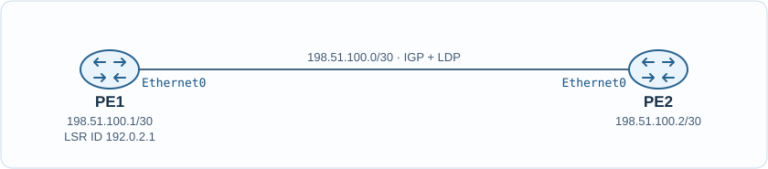

# 建立核心 MPLS 和 LDP

## 拓扑



## 配置条件

先规划两端 LSR ID、核心三层链路和 IGP 路由。以下配置包含 PE1 的接口、IGP 和 LDP。

在核心链路开通 IPv4 底层连通，使用稳定且全网唯一的 LSR ID，并在 IGP 中通告其主机地址。两端在核心三层接口启用 MPLS 和 LDP。以下示例使用一条核心链路。

## 配置步骤

```vortexros-config
#
sysname PE1
#
mpls lsr-id 192.0.2.1
mpls
#
mpls ldp
#
interface LoopBack0
 ip address 192.0.2.1 255.255.255.255
#
interface Ethernet0
 ip address 198.51.100.1 255.255.255.252
 mpls
 mpls ldp
 ospf network-type p2p
#
ospf 1 router-id 192.0.2.1
 area 0.0.0.0
  network 192.0.2.1 0.0.0.0
  network 198.51.100.1 0.0.0.0
#
return
```

对端使用同一链路的另一有效地址及独立的 LSR ID。提交后核对两端 IGP 路由，再核对 LDP 会话、标签绑定和实际转发表。

## 验证方法

对照{ref}`本功能页的实测结果 <recorded-result-10-mpls-l3vpn-ldp>`可以核对设备实际显示的字段或业务表现。不同拓扑请按本案例的地址和接口检查。

对照以下命令和预期结果核对设备状态。

```vortexros-cli
display mpls interface
display mpls ldp interface
display mpls ldp peer
display mpls ldp binding
display mpls lsp
display mpls forwarding-table
```
