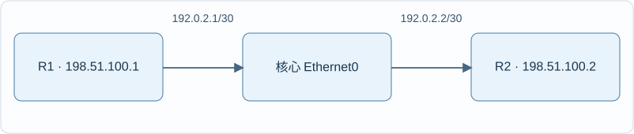

# 两端建立标签路径

## 拓扑



## 配置条件

先规划两端 LSR ID、核心三层链路和 IGP 路由。以下配置包含 PE1 的接口、IGP 和 LDP。

两台设备均在 DPDK 模式使用 Ethernet0 对接。核心链路使用 192.0.2.0/30。R1 与 R2 的 LSR ID 分别是 198.51.100.1 和 .2。分别录入后提交。

## 配置步骤

**本端设备**

```vortexros-config
mpls lsr-id 198.51.100.1
#
mpls
#
mpls ldp
#
interface LoopBack 0
 ip address 198.51.100.1 255.255.255.255
#
interface Ethernet 0
 ip address 192.0.2.1 255.255.255.252
 ipv6 enable
 mpls
 mpls ldp
 ospf network-type p2p
#
ospf 1 router-id 198.51.100.1
 area 0.0.0.0
  network 198.51.100.1 0.0.0.0
  network 192.0.2.1 0.0.0.0
#
return
```

**对端设备**

```vortexros-config
mpls lsr-id 198.51.100.2
#
mpls
#
mpls ldp
#
interface LoopBack 0
 ip address 198.51.100.2 255.255.255.255
#
interface Ethernet 0
 ip address 192.0.2.2 255.255.255.252
 ipv6 enable
 mpls
 mpls ldp
 ospf network-type p2p
#
ospf 1 router-id 198.51.100.2
 area 0.0.0.0
  network 198.51.100.2 0.0.0.0
  network 192.0.2.2 0.0.0.0
#
return
```

## 验证方法

对照以下命令和预期结果核对设备状态。

```vortexros-cli
display ospf peer brief
display mpls ldp peer
display mpls ldp binding
display mpls forwarding-table
```

两端 OSPF 邻居为 Full，LDP 会话为 OPERATIONAL。绑定表应能查到对端环回 /32，并显示对应的标签转发路径。标签值由设备分配。
