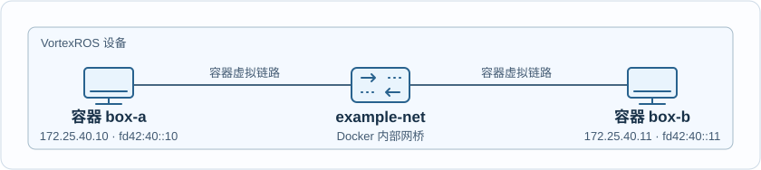

# 创建隔离应用桥

## 拓扑



## 配置条件

准备独立应用卷、支持应用桥的签名应用，以及在默认路由表可达的上联。先创建桥，再安装和启动使用该桥的应用。

## 配置步骤

```sh
sudo vortexros-image app bridge-create 192.0.2.0/24 2001:db8:400::/64 1420
sudo vortexros-image app bridge-status
```

在维护 shell 可使用 `app bridge-policy /path/policy.json` 设置受管策略。下例仅允许指定 HTTPS 目标、指定 DNS，并发布一个端口。应用必须使用与 target 一致的固定地址。

```json
{
  "uplink": "Ethernet2",
  "dns": [
    "198.51.100.2"
  ],
  "allow": [
    {
      "destination": "198.51.100.2/32",
      "protocol": "tcp",
      "port": 443
    }
  ],
  "publish": [
    {
      "application": "probe",
      "protocol": "tcp",
      "listen": "198.51.100.1:8443",
      "target": "192.0.2.10:443",
      "from": [
        "198.51.100.0/25"
      ]
    }
  ],
  "advertise": false
}
```

要撤销出口、端口发布及显式通告，执行 `sudo vortexros-image app bridge-policy-clear`。要删除桥，请先停止并移除使用该桥的应用。

## 验证方法

对照以下命令和预期结果核对设备状态。

```vortexros-cli
display ip routing-table
display ipv6 routing-table
```

从维护终端运行 app bridge-status，核对两族前缀和 MTU。允许桥内应用互通，默认表不出现显式发布的应用前缀。
