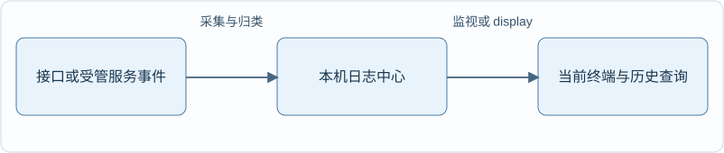

# 用接口变更核对日志与告警

## 操作流程



## 配置条件

先确定是临时调整当前终端，还是调整所有终端。查询历史记录可使用下面的 display 命令。

准备一个隔离测试端口，避免影响管理链路。在 Console 观察实时事件，通过另一台设备短时断开该端口再恢复。

## 配置步骤

准备一个隔离测试端口，避免影响管理链路。在 Console 观察实时事件，通过另一台设备短时断开该端口再恢复。

## 验证方法

对照{ref}`本功能页的实测结果 <recorded-result-operations-logs>`可以核对设备实际显示的字段或业务表现。不同拓扑请按本案例的地址和接口检查。

对照以下命令和预期结果核对设备状态。

```vortexros-cli
display interface brief
display logbuffer last 100
display alarm history last 100
```

接口简表应先显示 Down、再恢复 Up。日志应包含同一接口的两次状态变化，各事件显示一次本地时间。只有实际触发告警的事件才出现在告警历史中。
